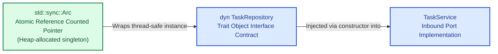

# Chapter 0: Rust Primer for Java Engineers
### *Translating JVM Expertise to Systems-Level Fearless Concurrency*

As a senior Java engineer, you already know design patterns, concurrency hazards, and architectural boundaries. Your challenge in Rust is not software engineering—it is adjusting your mental model of **memory**, **state**, and **dispatch**.

This primer bridges every fundamental Rust concept directly to its Java equivalent.

---

## 1. Memory: The JVM vs. The Borrow Checker

In the Java Virtual Machine, memory management is deferred to runtime: you allocate freely (`new`), references multiply across threads, and the Garbage Collector (G1, ZGC) traverses object graphs, occasionally stopping or delaying execution threads.

Rust eliminates the garbage collector completely without requiring manual `malloc`/`free`. Instead, memory management is enforced at **compile time** via **Ownership and Borrowing**.

```mermaid
graph TD
    classDef javaStyle fill:#fee2e2,stroke:#dc2626,stroke-width:2px,color:#7f1d1d;
    classDef rustStyle fill:#dcfce7,stroke:#16a34a,stroke-width:2px,color:#14532d;
    classDef noteStyle fill:#fef3c7,stroke:#d97706,stroke-width:2px,color:#78350f;

    subgraph "Java Runtime Model (Garbage Collected)"
        JAlloc["`Object a = new Object();<br/>Object b = a;`"]:::javaStyle
        JHeap["Shared Heap Allocation<br/>(Multiple references alias same memory)"]:::javaStyle
        JGC["GC Background Thread<br/>(Traverses GC roots, stop-the-world sweeps)"]:::noteStyle
        JAlloc --> JHeap
        JHeap -.->|Cleaned by| JGC
    end

    subgraph "Rust Compile-Time Model (Affine Type System)"
        RAlloc["`let a = String::from(&quot;data&quot;);`<br/>`let b = a; // Ownership MOVED`"]:::rustStyle
        ROwner["Single Deterministic Owner: 'b'<br/>('a' becomes invalid at compile-time)"]:::rustStyle
        RDrop["Deterministic Free: drop()<br/>(Invoked immediately at end of scope '{ }')"]:::rustStyle
        RAlloc --> ROwner
        ROwner -->|Scope exits| RDrop
    end
```

### The Three Rules of Rust Ownership
1. **Each value in Rust has an owner variable.**
2. **There can only be one owner at a time.** When assigning an object to another variable or passing it by value to a function, ownership **moves**. The old variable ceases to exist in the compiler's eyes.
3. **When the owner goes out of scope, the memory is dropped immediately.** (Identical to C++ RAII or a Java `try-with-resources` block executed automatically on every single variable).

---

## 2. References: Aliasing vs. Mutation

In Java, every variable holding an `Object` is an implicit, mutable reference:
```java
// Java: Data race waiting to happen
User user = new User("Alice");
threadPool.submit(() -> user.setName("Bob"));
threadPool.submit(() -> System.out.println(user.getName()));
```

Rust replaces implicit references with explicit borrowing rules governed by the **Aliasing XOR Mutability** axiom:

> At any point in time, you can have **either** of the following, but never both simultaneously:
> 1. Any number of immutable references (`&T`) to a resource.
> 2. Exactly one mutable reference (`&mut T`) to a resource.

```rust
struct User {
    name: String,
}

fn main() {
    let mut user = User { name: String::from("Alice") };

    // 1. Immutable Borrow (&) - Read-only view
    let r1 = &user;
    let r2 = &user;
    println!("Reading: {} and {}", r1.name, r2.name); // OK: Multiple readers

    // 2. Mutable Borrow (&mut) - Exclusive writer
    // let r3 = &mut user; // COMPILE ERROR if r1 or r2 are still used later!

    let writer = &mut user;
    writer.name = String::from("Bob"); // OK: Exclusive access
    println!("Updated: {}", writer.name);
}
```

Because of this rule, **data races are mathematically impossible** at compile time in Safe Rust.

---

## 3. Data Structures: Classes vs. Structs + Enums

Java uses polymorphic classes containing fields, constructors, and methods in one unified file. Rust decouples data storage from functions.

### Structs & Impl Blocks
- A `struct` holds only fields (like a C `struct` or a Java `record`).
- An `impl` block defines methods and static constructors.

```rust
// 1. Plain data structure (No implicit getters/setters)
#[derive(Debug, Clone)]
pub struct Customer {
    pub id: String,
    pub email: String,
    active: bool, // private to the module
}

// 2. Associated methods
impl Customer {
    // Static factory method (Java: public static Customer create(...))
    pub fn new(id: String, email: String) -> Self {
        Self {
            id,
            email,
            active: true,
        }
    }

    // Method taking immutable reference to self (Java: instance method reading 'this')
    pub fn is_active(&self) -> bool {
        self.active
    }

    // Method taking mutable reference to self (Java: instance method mutating 'this')
    pub fn deactivate(&mut self) {
        self.active = false;
    }
}
```

### Algebraic Enums: Beyond Java Enums
In Java, an `enum` represents a fixed set of singleton objects. In Rust, an `enum` is a tagged union where each variant can hold distinct types and values:

```rust
#[derive(Debug)]
pub enum WebhookEvent {
    Ping,                                   // Unit variant (No payload)
    OrderCreated { id: String, total: u64 }, // Named struct payload
    PaymentReceived(String, f64),           // Tuple payload
}

// Pattern matching (exhaustive switch expression)
fn handle_event(event: WebhookEvent) {
    match event {
        WebhookEvent::Ping => println!("Pong!"),
        WebhookEvent::OrderCreated { id, total } => {
            println!("Order {id} initialized with total: {total}");
        }
        WebhookEvent::PaymentReceived(tx_id, amount) => {
            println!("Processed ${amount:.2} on transaction {tx_id}");
        }
    }
}
```

---

## 4. Error Handling: `Result` vs. Exceptions

Java throws runtime or checked exceptions that bubble up the stack frame by frame, creating stack trace overhead and hiding control flow:

```java
// Java
try {
    Task t = service.findTask("42");
    t.complete();
} catch (TaskNotFoundException e) {
    log.error("Missing", e);
}
```

In Rust, there are no unhandled exceptions. Errors are typesafe algebraic values returned via `Result<T, E>` and `Option<T>`:

```rust
// Standard library definitions:
// enum Option<T> { Some(T), None }
// enum Result<T, E> { Ok(T), Err(E) }

fn divide(a: f64, b: f64) -> Result<f64, String> {
    if b == 0.0 {
        Err(String::from("Division by zero"))
    } else {
        Ok(a / b)
    }
}
```

### The `?` Operator (Early-Return Sugar)
Instead of verbose nested checks, the `?` operator unboxes `Ok(value)` or returns `Err(e)` immediately from the enclosing function:

```rust
fn execute_calculation() -> Result<f64, String> {
    // If divide() returns Err, it returns from execute_calculation immediately!
    let first = divide(100.0, 2.0)?; 
    let second = divide(first, 5.0)?;
    Ok(second)
}
```

---

## 5. Abstraction: Interfaces vs. Traits

Java uses interfaces to achieve polymorphism, typically dispatching every call dynamically through a `vtable` (virtual method table):

```java
public interface Greeter {
    void greet(String name);
}
```

Rust uses **Traits**. Traits can be dispatched in two ways:

1. **Static Dispatch (Generics / Monomorphization):** The compiler generates specialized machine code for each type implementing the trait. Zero runtime overhead.
2. **Dynamic Dispatch (`dyn Trait`):** Used when heterogeneous types must be stored together or injected dynamically (e.g., dependency injection).

```rust
pub trait Greeter: Send + Sync {
    fn greet(&self, name: &str) -> String;
}

pub struct EnglishGreeter;
impl Greeter for EnglishGreeter {
    fn greet(&self, name: &str) -> String {
        format!("Hello, {name}!")
    }
}

// 1. Static dispatch (Java generic <T extends Greeter>)
pub fn run_static<T: Greeter>(greeter: T) {
    println!("{}", greeter.greet("World"));
}

// 2. Dynamic dispatch via Smart Pointer (Java interface reference)
pub fn run_dynamic(greeter: &dyn Greeter) {
    println!("{}", greeter.greet("World"));
}
```

---

## 6. Dependency Injection: Spring `@Autowired` vs. Rust `Arc<dyn Trait>`

In Spring Boot, the framework scans classpaths at startup, builds an application context, and injects instances into fields:

```java
@Service
public class TaskService {
    @Autowired
    private TaskRepository repo;
}
```

In Rust, dependency injection is clean, explicit, and compile-time verified without bytecode manipulation or runtime reflections:



- **`Box<dyn Trait>`**: Unique ownership of a trait implementation on the heap (Single-owner DI).
- **`Arc<dyn Trait>`**: Thread-safe shared ownership of a trait implementation (Shared Singleton DI across multiple worker threads).

```rust
use std::sync::Arc;

pub struct TaskService {
    repo: Arc<dyn TaskRepository>, // Pure constructor injection
}

impl TaskService {
    pub fn new(repo: Arc<dyn TaskRepository>) -> Self {
        Self { repo }
    }
}
```

---

## 7. Tooling: Maven / Gradle vs. Cargo

| Build Step | Maven / Gradle | Rust Cargo |
| :--- | :--- | :--- |
| **Manifest File** | `pom.xml` / `build.gradle.kts` | `Cargo.toml` |
| **Lock File** | `gradle.lockfile` | `Cargo.lock` |
| **Compile & Run** | `./gradlew bootRun` / `mvn spring-boot:run` | `cargo run` |
| **Run Tests** | `./gradlew test` / `mvn test` | `cargo test` |
| **Linter / Code Style** | Checkstyle / SpotBugs / SonarQube | `cargo clippy` |
| **Code Formatter** | Spotless | `cargo fmt` |
| **Production Build** | `./gradlew bootJar` | `cargo build --release` |

With this foundational comparison in mind, you are ready to begin **Chapter 1** and design your pure domain core.