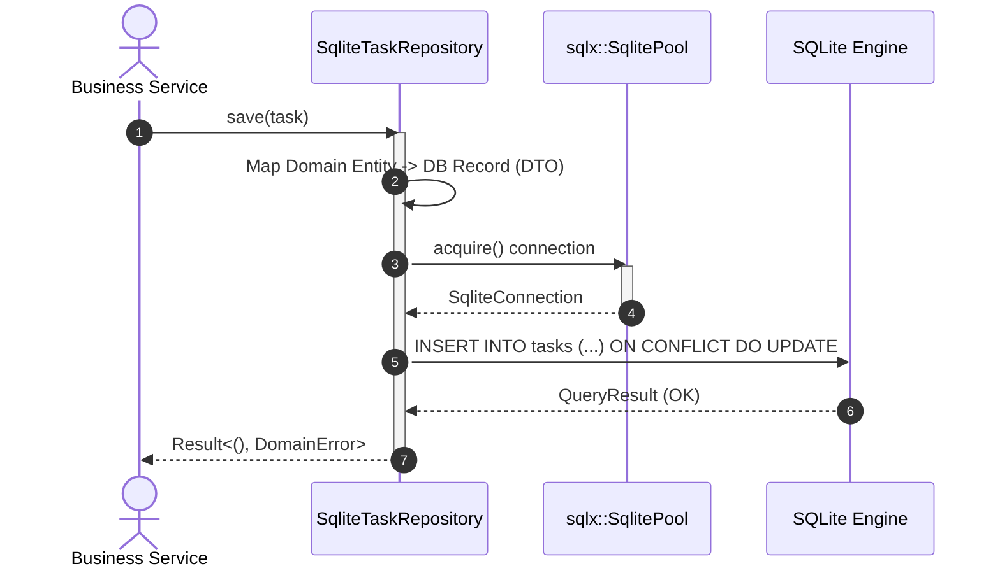

# Chapter 2: Persistence Adapter with SQLite & SQLx
### Milestone 2: Driving Outbound Storage via Connection Pooling & Mappers

In this milestone, we implement the secondary outbound port `TaskRepository` using **SQLx** and **SQLite**.

---

## 1. SQLx vs. JDBC / Hibernate

- **Hibernate/JPA** executes heavy runtime reflection, proxying, and runtime JPQL validation.
- **SQLx** provides asynchronous, compile-time verified database interactions with built-in connection pooling similar to HikariCP.



---

## 2. Database Migrations

Create an SQL migration file at `migrations/20261031000000_create_tasks.sql`:
```sql
CREATE TABLE IF NOT EXISTS tasks (
    id TEXT PRIMARY KEY NOT NULL,
    title TEXT NOT NULL,
    description TEXT,
    status TEXT NOT NULL
);
```

---

## 3. Implementing the Outbound Adapter

### `src/adapters/persistence/sqlite_repo.rs`
```rust
use async_trait::async_trait;
use sqlx::{SqlitePool, Row};
use crate::domain::model::{Task, TaskStatus};
use crate::domain::error::DomainError;
use crate::ports::outbound::TaskRepository;

/// The concrete secondary adapter (Java: @Repository public class SqliteTaskRepositoryImpl)
#[derive(Clone)]
pub struct SqliteTaskRepository {
    pool: SqlitePool, // Equivalent to javax.sql.DataSource or HikariPool
}

impl SqliteTaskRepository {
    pub fn new(pool: SqlitePool) -> Self {
        Self { pool }
    }
}

#[async_trait]
impl TaskRepository for SqliteTaskRepository {
    async fn find_by_id(&self, id: &str) -> Result<Option<Task>, DomainError> {
        let row = sqlx::query("SELECT id, title, description, status FROM tasks WHERE id = ?")
            .bind(id)
            .fetch_optional(&self.pool)
            .await
            .map_err(|e| DomainError::Infrastructure(e.to_string()))?;

        row.map(|r| {
            let status_str: String = r.get("status");
            let status = match status_str.as_str() {
                "COMPLETED" => TaskStatus::Completed,
                "IN_PROGRESS" => TaskStatus::InProgress,
                _ => TaskStatus::Pending,
            };

            Ok(Task {
                id: r.get("id"),
                title: r.get("title"),
                description: r.get("description"),
                status,
            })
        }).transpose()
    }

    async fn save(&self, task: &Task) -> Result<(), DomainError> {
        sqlx::query(
            r#"
            INSERT INTO tasks (id, title, description, status)
            VALUES (?, ?, ?, ?)
            ON CONFLICT(id) DO UPDATE SET
                title = excluded.title,
                description = excluded.description,
                status = excluded.status
            "#
        )
        .bind(&task.id)
        .bind(&task.title)
        .bind(&task.description)
        .bind(task.status.to_string())
        .execute(&self.pool)
        .await
        .map_err(|e| DomainError::Infrastructure(e.to_string()))?;

        Ok(())
    }

    async fn list_all(&self) -> Result<Vec<Task>, DomainError> {
        let rows = sqlx::query("SELECT id, title, description, status FROM tasks")
            .fetch_all(&self.pool)
            .await
            .map_err(|e| DomainError::Infrastructure(e.to_string()))?;

        let mut tasks = Vec::new();
        for r in rows {
            let status_str: String = r.get("status");
            let status = match status_str.as_str() {
                "COMPLETED" => TaskStatus::Completed,
                "IN_PROGRESS" => TaskStatus::InProgress,
                _ => TaskStatus::Pending,
            };
            tasks.push(Task {
                id: r.get("id"),
                title: r.get("title"),
                description: r.get("description"),
                status,
            });
        }
        Ok(tasks)
    }
}
```

### `src/adapters/persistence/mod.rs`
```rust
pub mod sqlite_repo;
```

---

## 4. Milestone 2 Verification: Integration Test

Create an integration test to verify the storage adapter using an in-memory SQLite database without starting an HTTP or GUI server. Add this to `src/adapters/persistence/sqlite_repo.rs`:

```rust
#[cfg(test)]
mod tests {
    use super::*;
    use sqlx::sqlite::SqlitePoolOptions;

    #[tokio::test]
    async fn test_sqlite_adapter_crud() {
        let pool = SqlitePoolOptions::new()
            .connect("sqlite::memory:")
            .await
            .unwrap();

        // Run schema directly
        sqlx::query(
            r#"
            CREATE TABLE tasks (
                id TEXT PRIMARY KEY NOT NULL,
                title TEXT NOT NULL,
                description TEXT,
                status TEXT NOT NULL
            );
            "#
        )
        .execute(&pool)
        .await
        .unwrap();

        let repo = SqliteTaskRepository::new(pool);
        let task = Task::new("task-1".to_string(), "Verify SQLite".to_string(), Some("Test description".to_string())).unwrap();

        // Save
        repo.save(&task).await.unwrap();

        // Find
        let found = repo.find_by_id("task-1").await.unwrap().expect("Should exist");
        assert_eq!(found.title, "Verify SQLite");
        assert_eq!(found.description, Some("Test description".to_string()));

        // Update
        let mut updated_task = found;
        updated_task.complete();
        repo.save(&updated_task).await.unwrap();

        let re_found = repo.find_by_id("task-1").await.unwrap().expect("Should exist");
        assert_eq!(re_found.status, TaskStatus::Completed);
    }
}
```

Run test suite:
```bash
cargo test adapters::persistence::sqlite_repo::tests
```
You have completed **Milestone 2**: Persistent, typesafe relational storage matching the Domain's contract.