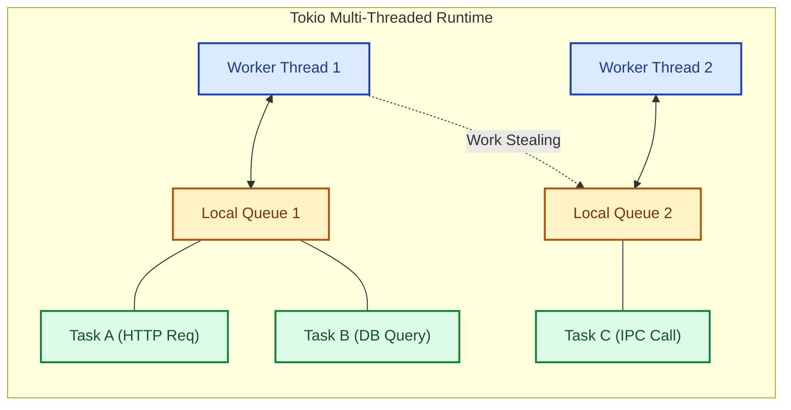

# Chapter 3: Driving HTTP Layer with Axum & Tokio
### Milestone 3: High-Throughput REST Adapter & Global Error Transformation

In this milestone, we attach our first primary (driving) adapter: an async REST API built with **Axum** running on the **Tokio** multithreaded runtime.

---

## 1. Tokio Concurrency vs. Java Virtual Threads (Project Loom)

- **Java (Spring on Loom):** Imperative syntax blocking on virtual threads. Underlying carrier threads switch during I/O.
- **Rust (Tokio):** Explicit `async`/`await` state machines. Tasks are scheduled across an M:N worker pool with zero OS context switching overhead.



---

## 2. HTTP DTOs & Error Handler Middleware

In Spring Boot, you throw a `DomainNotFoundException` and handle it using `@ControllerAdvice`. In Axum, you implement `IntoResponse` for your application error type.

### `src/adapters/http/error_response.rs`
```rust
use axum::{
    response::{IntoResponse, Response},
    http::StatusCode,
    Json,
};
use serde_json::json;
use crate::domain::error::DomainError;

pub struct HttpAppError(pub DomainError);

impl IntoResponse for HttpAppError {
    fn into_response(self) -> Response {
        let (status, error_message) = match self.0 {
            DomainError::NotFound(msg) => (StatusCode::NOT_FOUND, msg),
            DomainError::Validation(msg) => (StatusCode::BAD_REQUEST, msg),
            DomainError::Infrastructure(msg) => (StatusCode::INTERNAL_SERVER_ERROR, msg),
        };

        let body = Json(json!({
            "error": error_message,
            "status": status.as_u16()
        }));

        (status, body).into_response()
    }
}

// Ergonomic conversion from DomainError -> HttpAppError via ? operator
impl From<DomainError> for HttpAppError {
    fn from(err: DomainError) -> Self {
        HttpAppError(err)
    }
}
```

---

## 3. REST Handlers (Spring `@RestController`)

### `src/adapters/http/handlers.rs`
```rust
use std::sync::Arc;
use axum::{
    extract::{Path, State},
    http::StatusCode,
    Json,
};
use serde::{Deserialize, Serialize};
use crate::ports::inbound::TaskUseCase;
use crate::adapters::http::error_response::HttpAppError;

// DTOs (Data Transfer Objects)
#[derive(Deserialize)]
pub struct CreateTaskRequest {
    pub title: String,
    pub description: Option<String>,
}

#[derive(Serialize, Deserialize, Debug, PartialEq)]
pub struct TaskResponse {
    pub id: String,
    pub title: String,
    pub description: Option<String>,
    pub status: String,
}

// Injected State (Spring Bean holder)
pub type AppState = Arc<dyn TaskUseCase>;

pub async fn create_task_handler(
    State(service): State<AppState>,
    Json(payload): Json<CreateTaskRequest>,
) -> Result<(StatusCode, Json<TaskResponse>), HttpAppError> {
    let task = service.create_task(payload.title, payload.description).await?;
    
    Ok((StatusCode::CREATED, Json(TaskResponse {
        id: task.id,
        title: task.title,
        description: task.description,
        status: task.status.to_string(),
    })))
}

pub async fn get_task_handler(
    State(service): State<AppState>,
    Path(id): Path<String>,
) -> Result<Json<TaskResponse>, HttpAppError> {
    let task = service.get_task(&id).await?;
    
    Ok(Json(TaskResponse {
        id: task.id,
        title: task.title,
        description: task.description,
        status: task.status.to_string(),
    }))
}

pub async fn list_tasks_handler(
    State(service): State<AppState>,
) -> Result<Json<Vec<TaskResponse>>, HttpAppError> {
    let tasks = service.list_tasks().await?;
    let response = tasks.into_iter().map(|task| TaskResponse {
        id: task.id,
        title: task.title,
        description: task.description,
        status: task.status.to_string(),
    }).collect();

    Ok(Json(response))
}

pub async fn complete_task_handler(
    State(service): State<AppState>,
    Path(id): Path<String>,
) -> Result<Json<TaskResponse>, HttpAppError> {
    let task = service.complete_task(&id).await?;

    Ok(Json(TaskResponse {
        id: task.id,
        title: task.title,
        description: task.description,
        status: task.status.to_string(),
    }))
}
```

---

## 4. Assembling the Router and Module Structure

### `src/adapters/http/mod.rs`
```rust
pub mod handlers;
pub mod error_response;

use axum::{routing::{get, post, patch}, Router};
use std::sync::Arc;
use crate::ports::inbound::TaskUseCase;

pub fn create_router(service: Arc<dyn TaskUseCase>) -> Router {
    Router::new()
        .route("/api/v1/tasks", post(handlers::create_task_handler))
        .route("/api/v1/tasks", get(handlers::list_tasks_handler))
        .route("/api/v1/tasks/:id", get(handlers::get_task_handler))
        .route("/api/v1/tasks/:id/complete", patch(handlers::complete_task_handler))
        .with_state(service)
}
```

### `src/adapters/mod.rs`
```rust
pub mod persistence;
pub mod http;
pub mod tauri_ipc;
```

---

## 5. Milestone 3 Verification: HTTP End-to-End Test

Test the Axum routes without opening a network port using `axum::serve` or `tower::ServiceExt`:

```rust
#[cfg(test)]
mod tests {
    use super::*;
    use axum::{
        body::Body,
        http::{Request, StatusCode},
    };
    use tower::ServiceExt; // for `oneshot`
    use crate::domain::model::Task;
    use crate::domain::error::DomainError;
    use async_trait::async_trait;

    struct DummyService;

    #[async_trait]
    impl TaskUseCase for DummyService {
        async fn create_task(&self, title: String, description: Option<String>) -> Result<Task, DomainError> {
            Ok(Task::new("123".into(), title, description).unwrap())
        }
        async fn get_task(&self, _id: &str) -> Result<Task, DomainError> {
            Ok(Task::new("123".into(), "Mocked".into(), None).unwrap())
        }
        async fn complete_task(&self, _id: &str) -> Result<Task, DomainError> {
            let mut t = Task::new("123".into(), "Mocked".into(), None).unwrap();
            t.complete();
            Ok(t)
        }
        async fn list_tasks(&self) -> Result<Vec<Task>, DomainError> {
            Ok(vec![Task::new("123".into(), "Mocked".into(), None).unwrap()])
        }
    }

    #[tokio::test]
    async fn test_create_task_route() {
        let router = create_router(Arc::new(DummyService));

        let response = router
            .oneshot(
                Request::builder()
                    .method("POST")
                    .uri("/api/v1/tasks")
                    .header("content-type", "application/json")
                    .body(Body::from(r#"{"title":"Write Axum tests","description":null}"#))
                    .unwrap(),
            )
            .await
            .unwrap();

        assert_eq!(response.status(), StatusCode::CREATED);
    }
}
```

Run test suite:
```bash
cargo test adapters::http::tests
```
You have achieved **Milestone 3**: Clean, typesafe HTTP delivery decoupled from database and core models.