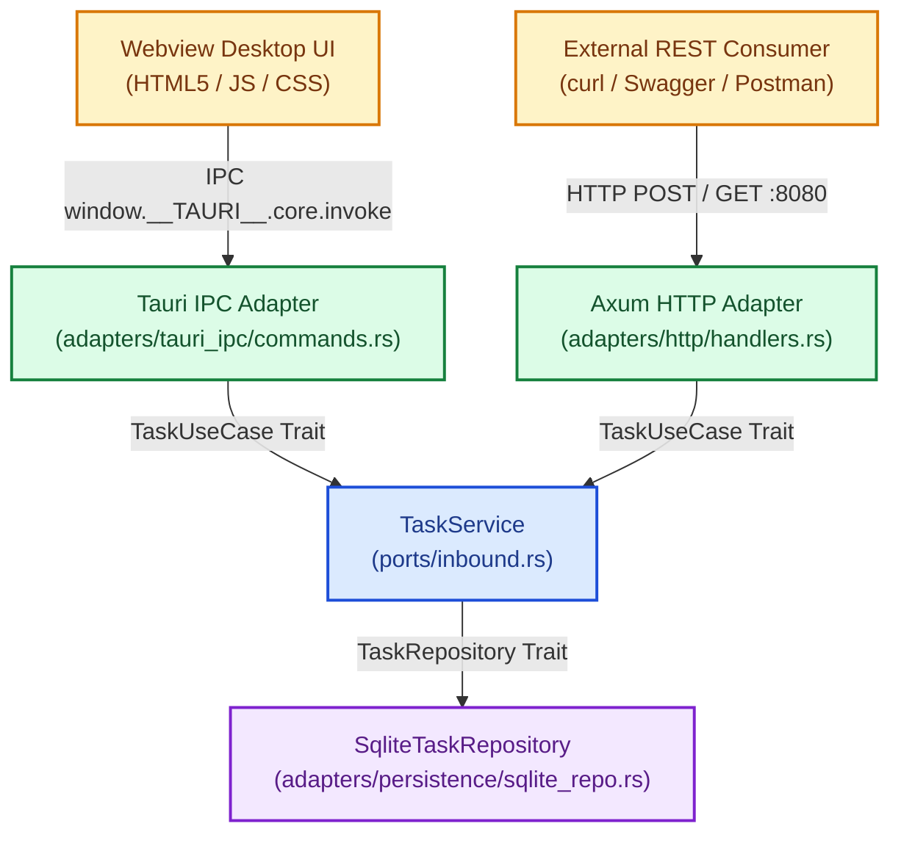

# Chapter 4: Cross-Platform Native IPC with Tauri
### Milestone 4: Dual Primary Adapters (HTTP & Desktop) Sharing One Service

In this final milestone, we build a cross-platform desktop application where **Axum** (HTTP REST) and **Tauri** (Desktop IPC) run side by side as primary driving adapters, sharing the exact same inbound domain port (`TaskUseCase`).

Every file in this chapter is complete and directly copy-pasteable into your project.

---

## 1. Dual-Driver Architecture



---

## 2. Complete Dependency Configuration: `Cargo.toml`

Replace your root `Cargo.toml` with this complete configuration:

```toml
[package]
name = "taskforge"
version = "0.1.0"
edition = "2021"

[dependencies]
# Tokio Runtime (Project Loom / Executor equivalent)
tokio = { version = "1.40", features = ["full"] }

# Axum HTTP Framework (Spring Web / REST equivalent)
axum = "0.7"

# SQLx SQLite Driver & Connection Pool (JDBC / Hikari equivalent)
sqlx = { version = "0.8", features = ["runtime-tokio-rustls", "sqlite", "macros", "migrate"] }

# Tauri Desktop IPC Framework
tauri = { version = "2.0", features = [] }

# Async traits (allows async methods in trait definitions)
async-trait = "0.1"

# Serialization & Deserialization (Jackson equivalent)
serde = { version = "1.0", features = ["derive"] }
serde_json = "1.0"

# UUID Generator
uuid = { version = "1.10", features = ["v4"] }

[build-dependencies]
tauri-build = "2.0"
```

---

## 3. Tauri Build Hook: `build.rs`

Place this in the root directory alongside `Cargo.toml`:

```rust
fn main() {
    tauri_build::build();
}
```

---

## 4. Tauri Configuration: `tauri.conf.json`

Create `tauri.conf.json` in your project root:

```json
{
  "$schema": "https://raw.githubusercontent.com/tauri-apps/tauri/dev/crates/tauri-config-schema/schema.json",
  "productName": "TaskForge",
  "version": "0.1.0",
  "identifier": "com.taskforge.desktop",
  "build": {
    "frontendDist": "./ui"
  },
  "app": {
    "windows": [
      {
        "title": "TaskForge Clean Architecture",
        "width": 900,
        "height": 650,
        "resizable": true
      }
    ],
    "security": {
      "csp": null
    }
  }
}
```

---

## 5. Tauri IPC Command Adapter

### `src/adapters/tauri_ipc/mod.rs`
```rust
pub mod commands;
```

### `src/adapters/tauri_ipc/commands.rs`
```rust
use std::sync::Arc;
use serde::{Deserialize, Serialize};
use tauri::State;
use crate::ports::inbound::TaskUseCase;

#[derive(Serialize, Deserialize, Debug)]
pub struct IpcTaskPayload {
    pub id: String,
    pub title: String,
    pub description: Option<String>,
    pub status: String,
}

#[derive(Deserialize, Debug)]
pub struct CreateIpcTaskInput {
    pub title: String,
    pub description: Option<String>,
}

#[tauri::command]
pub async fn create_task_ipc(
    payload: CreateIpcTaskInput,
    service: State<'_, Arc<dyn TaskUseCase>>,
) -> Result<IpcTaskPayload, String> {
    let task = service
        .create_task(payload.title, payload.description)
        .await
        .map_err(|e| e.to_string())?;

    Ok(IpcTaskPayload {
        id: task.id,
        title: task.title,
        description: task.description,
        status: task.status.to_string(),
    })
}

#[tauri::command]
pub async fn list_tasks_ipc(
    service: State<'_, Arc<dyn TaskUseCase>>,
) -> Result<Vec<IpcTaskPayload>, String> {
    let tasks = service
        .list_tasks()
        .await
        .map_err(|e| e.to_string())?;

    Ok(tasks
        .into_iter()
        .map(|task| IpcTaskPayload {
            id: task.id,
            title: task.title,
            description: task.description,
            status: task.status.to_string(),
        })
        .collect())
}

#[tauri::command]
pub async fn complete_task_ipc(
    id: String,
    service: State<'_, Arc<dyn TaskUseCase>>,
) -> Result<IpcTaskPayload, String> {
    let task = service
        .complete_task(&id)
        .await
        .map_err(|e| e.to_string())?;

    Ok(IpcTaskPayload {
        id: task.id,
        title: task.title,
        description: task.description,
        status: task.status.to_string(),
    })
}
```

---

## 6. Composition Root: `src/main.rs`

This file initializes SQLite, runs database migrations, assembles the Hexagonal dependencies, launches Axum in a background Tokio task, and starts the Tauri window loop.

```rust
mod domain;
mod ports;
mod adapters;

use std::sync::Arc;
use sqlx::sqlite::SqlitePoolOptions;
use tokio::net::TcpListener;

use ports::inbound::{TaskService, TaskUseCase};
use ports::outbound::TaskRepository;
use adapters::persistence::sqlite_repo::SqliteTaskRepository;
use adapters::http::create_router;
use adapters::tauri_ipc::commands::{create_task_ipc, list_tasks_ipc, complete_task_ipc};

fn main() {
    // 1. Build Multi-Threaded Tokio Runtime
    let runtime = tokio::runtime::Builder::new_multi_thread()
        .enable_all()
        .build()
        .expect("Failed to initialize Tokio runtime");

    // 2. Initialize Database & Business Dependencies inside the Tokio Runtime
    let (service, pool) = runtime.block_on(async {
        let db_url = "sqlite::memory:"; // Alternatively: "sqlite://taskforge.db?mode=rwc"
        let pool = SqlitePoolOptions::new()
            .max_connections(5)
            .connect(db_url)
            .await
            .expect("Failed to connect to SQLite database");

        // Execute In-Memory Schema Setup
        sqlx::query(
            r#"
            CREATE TABLE IF NOT EXISTS tasks (
                id TEXT PRIMARY KEY NOT NULL,
                title TEXT NOT NULL,
                description TEXT,
                status TEXT NOT NULL
            );
            "#
        )
        .execute(&pool)
        .await
        .expect("Failed to initialize database table");

        let repository: Arc<dyn TaskRepository> = Arc::new(SqliteTaskRepository::new(pool.clone()));
        let service: Arc<dyn TaskUseCase> = Arc::new(TaskService::new(repository));

        (service, pool)
    });

    // 3. Spawn Axum REST API in Background Tokio Task
    let http_service = Arc::clone(&service);
    runtime.spawn(async move {
        let app = create_router(http_service);
        let listener = TcpListener::bind("127.0.0.1:8080")
            .await
            .expect("Port 8080 already in use");
        println!("🚀 REST API running at http://127.0.0.1:8080/api/v1/tasks");
        axum::serve(listener, app).await.unwrap();
    });

    // 4. Run Tauri Desktop Runtime on Main Operating System Thread
    tauri::Builder::default()
        .manage(Arc::clone(&service)) // Register Port into Tauri State Registry
        .invoke_handler(tauri::generate_handler![
            create_task_ipc,
            list_tasks_ipc,
            complete_task_ipc
        ])
        .run(tauri::generate_context!())
        .expect("Error while running Tauri desktop application");

    // Suppress unused pool warning
    drop(pool);
}
```

---

## 7. Embedded Desktop Frontend: `ui/index.html`

Create a folder named `ui` in your project root with the following `index.html`:

```html
<!DOCTYPE html>
<html lang="en">
<head>
  <meta charset="UTF-8">
  <title>TaskForge</title>
  <style>
    body { font-family: -apple-system, BlinkMacSystemFont, "Segoe UI", Roboto, sans-serif; margin: 2rem; background: #f8fafc; color: #1e293b; }
    h1 { margin-bottom: 0.5rem; color: #0f172a; }
    p.subtitle { color: #64748b; margin-top: 0; margin-bottom: 1.5rem; }
    .form-group { display: flex; gap: 0.5rem; margin-bottom: 1.5rem; }
    input { padding: 0.6rem 0.8rem; border: 1px solid #cbd5e1; border-radius: 4px; font-size: 0.95rem; }
    input[name="title"] { flex: 2; }
    input[name="desc"] { flex: 3; }
    button { padding: 0.6rem 1.2rem; background: #2563eb; color: white; border: none; border-radius: 4px; cursor: pointer; font-weight: 600; }
    button:hover { background: #1d4ed8; }
    table { width: 100%; border-collapse: collapse; background: white; border-radius: 6px; overflow: hidden; box-shadow: 0 1px 3px rgba(0,0,0,0.1); }
    th, td { padding: 0.75rem 1rem; text-align: left; border-bottom: 1px solid #e2e8f0; }
    th { background: #f1f5f9; font-weight: 600; }
    .status-badge { padding: 0.2rem 0.5rem; border-radius: 4px; font-size: 0.8rem; font-weight: 700; }
    .badge-PENDING { background: #fef3c7; color: #92400e; }
    .badge-COMPLETED { background: #dcfce7; color: #166534; }
    .action-btn { background: #10b981; padding: 0.3rem 0.6rem; font-size: 0.8rem; }
    .action-btn:hover { background: #059669; }
  </style>
</head>
<body>
  <h1>TaskForge Control Center</h1>
  <p class="subtitle">Hexagonal Architecture with Axum (Port 8080) & Native Tauri IPC</p>

  <div class="form-group">
    <input type="text" id="titleInput" placeholder="Task title..." />
    <input type="text" id="descInput" placeholder="Description (optional)..." />
    <button onclick="createTask()">Create Task</button>
  </div>

  <table>
    <thead>
      <tr>
        <th>ID</th>
        <th>Title</th>
        <th>Description</th>
        <th>Status</th>
        <th>Action</th>
      </tr>
    </thead>
    <tbody id="taskTableBody"></tbody>
  </table>

  <script>
    const invoke = window.__TAURI__ ? window.__TAURI__.core.invoke : null;

    async function refreshTasks() {
      if (!invoke) return;
      try {
        const tasks = await invoke('list_tasks_ipc');
        const tbody = document.getElementById('taskTableBody');
        tbody.innerHTML = '';
        tasks.forEach(t => {
          const row = document.createElement('tr');
          row.innerHTML = `
            <td><code>${t.id.substring(0, 8)}...</code></td>
            <td><strong>${t.title}</strong></td>
            <td>${t.description || '<em>None</em>'}</td>
            <td><span class="status-badge badge-${t.status}">${t.status}</span></td>
            <td>
              ${t.status !== 'COMPLETED' ? `<button class="action-btn" onclick="completeTask('${t.id}')">Complete</button>` : '✓ Done'}
            </td>
          `;
          tbody.appendChild(row);
        });
      } catch (err) {
        console.error('Failed to list tasks:', err);
      }
    }

    async function createTask() {
      const title = document.getElementById('titleInput').value.trim();
      const description = document.getElementById('descInput').value.trim() || null;
      if (!title) return;

      try {
        await invoke('create_task_ipc', { payload: { title, description } });
        document.getElementById('titleInput').value = '';
        document.getElementById('descInput').value = '';
        await refreshTasks();
      } catch (err) {
        alert('Error: ' + err);
      }
    }

    async function completeTask(id) {
      try {
        await invoke('complete_task_ipc', { id });
        await refreshTasks();
      } catch (err) {
        alert('Error: ' + err);
      }
    }

    window.addEventListener('DOMContentLoaded', refreshTasks);
  </script>
</body>
</html>
```

---

## 8. Verification and Execution

Run the complete dual-mode system:

```bash
cargo run
```

While the desktop window is open:
1. Create and complete tasks directly inside the GUI.
2. In a separate terminal, test the concurrently running Axum HTTP server:

```bash
curl -s http://localhost:8080/api/v1/tasks | jq .
```

Both interfaces mutate and query the exact same business logic through the Inbound Port, demonstrating a complete Hexagonal Architecture in Rust.