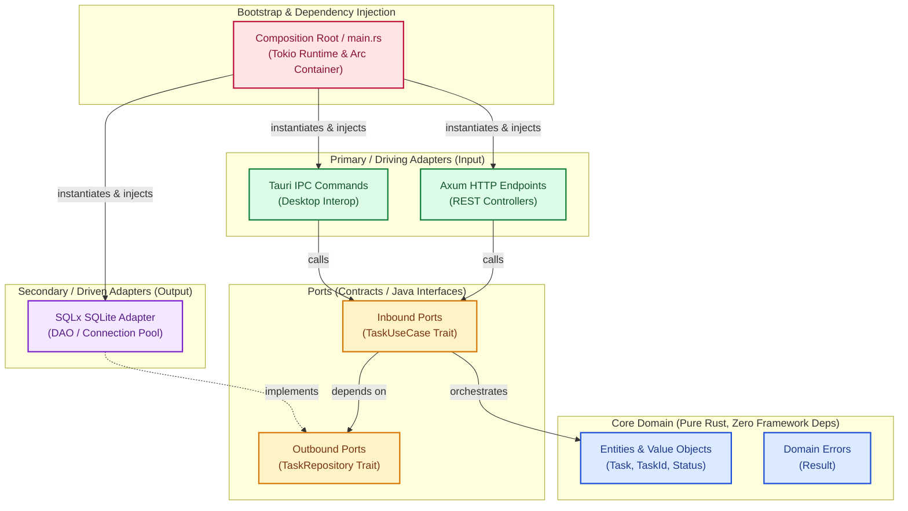

# Enterprise Rust: Clean Hexagonal Architecture with Axum, Tokio, Tauri & SQLite
### *A Complete, Copy-Paste Guide for Senior Java & Spring Engineers*

Welcome to this comprehensive, milestone-driven guide designed specifically for experienced Java, Spring, and JVM architects stepping into systems and cross-platform desktop development with **Rust**. 

We build a production-grade, offline-first task and workflow engine (**TaskForge**) combining a local HTTP/REST server and a native desktop UI, all backed by an embedded SQLite datastore.

---

## 🗺️ Architectural Blueprint: Hexagonal (Ports & Adapters)

To prevent your Rust code from degenerating into tight coupling or messy procedural scripts, we implement the strict **Hexagonal Architecture** (Clean Architecture / Ports & Adapters) standard you are familiar with from Spring Boot and domain-driven design.



---

## ☕ Java vs. Rust: Mental Model Translation Sheet

| Java / Spring Concept | Rust Equivalent | Key Operational Difference |
| :--- | :--- | :--- |
| `interface` | `trait` | Implemented retroactively via `impl Trait for Struct` without altering original struct. |
| POJO / JavaBean (`class`) | `struct` | Data and behavior are segregated; methods live in distinct `impl` blocks. No inheritance. |
| `Spring IoC Container` / `@Autowired` | Explicit Composition (`Arc<dyn Trait>`) | Zero-cost dependency injection done manually at application bootstrap (`main.rs`). |
| `try / catch / throw Exception` | `Result<T, E>` and `?` operator | Explicit error handling. Errors are typesafe values, not stack unwinding events. |
| Garbage Collector (G1 / ZGC) | **Borrow Checker** (Ownership & Lifetimes) | Deterministic compile-time deallocation (`Drop`). No GC pauses, no stop-the-world. |
| `Thread` / `CompletableFuture` | `tokio::task` & `async/.await` | Tokio uses green cooperative M:N fiber execution; futures are lazy until polled. |
| `AtomicReference<T>` | `std::sync::Arc<T>` | Thread-safe Atomic Reference Counting. |
| `ReentrantLock` | `tokio::sync::Mutex<T>` | The lock guards the *data*, not the block of code. |

---

## 📁 Complete Project Source Tree

Every file below is completely implemented in the chapters:

```text
taskforge/
├── Cargo.toml                                    # Project dependencies & build config
├── build.rs                                      # Tauri build hook
├── tauri.conf.json                               # Tauri desktop window configuration
├── migrations/
│   └── 20261031000000_create_tasks.sql           # SQLite schema migration
├── ui/
│   └── index.html                                # Native desktop HTML5 interface
└── src/
    ├── main.rs                                   # Application bootstrap & DI container
    ├── domain/
    │   ├── mod.rs                                # Module exports
    │   ├── model.rs                              # Pure domain entities & enums
    │   └── error.rs                              # Domain error types
    ├── ports/
    │   ├── mod.rs                                # Module exports
    │   ├── inbound.rs                            # TaskUseCase trait & TaskService implementation
    │   └── outbound.rs                           # TaskRepository trait
    └── adapters/
        ├── mod.rs                                # Module exports
        ├── persistence/
        │   ├── mod.rs                            # Persistence module exports
        │   └── sqlite_repo.rs                    # SQLx SQLite repository adapter
        ├── http/
        │   ├── mod.rs                            # Axum router construction
        │   ├── handlers.rs                       # Axum REST controllers & DTOs
        │   └── error_response.rs                 # Centralized REST error transformation
        └── tauri_ipc/
            ├── mod.rs                            # Tauri IPC module exports
            └── commands.rs                       # Tauri desktop commands
```

---

## 📑 Curriculum & Chapter Roadmap

Each chapter represents a fully working, executable milestone:

1. **[Chapter 0: Rust Primer for Java engineers](./chapter_0_rust_primer_for_java_engineers.md)**
   - *Milestone 1:* Bridges every fundamental Rust concept directly to its Java equivalent. 
2. **[Chapter 1: The Domain Core & Inversion of Control](./chapter_1_the_domain_core_inversion_of_control.md)**
   - *Milestone 2:* Define purely isolated business entities, domain errors, and Port traits using zero third-party dependencies.
3. **[Chapter 2: Persistence Adapter with SQLite & SQLx](./chapter_2_persistence_adapter_with_sqlite_sqlx.md)**
   - *Milestone 3:* Implement secondary outbound adapters, compile-time verified queries, and connection pooling.
4. **[Chapter 3: Driving HTTP Layer with Axum & Tokio](./chapter_3_driving_http_layer_with_axum_tokio.md)**
   - *Milestone 4:* Build the concurrent async REST web layer, state injection, and global error middleware.
5. **[Chapter 4: Cross-Platform Native IPC with Tauri](./chapter_4_cross_platform_native_ipc_with_tauri.md)**
   - *Milestone 5:* Unify the dual-driver system (HTTP + Desktop IPC) sharing the exact same injected domain services.