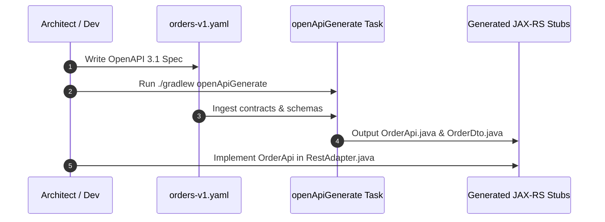

# Chapter 2: Contract-First API Spec & Automated Code Generation

**Milestone:** Define the REST API contract using OpenAPI 3.1 YAML and automate the generation of typed DTOs and JAX-RS interfaces via Gradle.

---

## 1. Sequence Flow of Contract Generation



---

## 2. API Contract: `orders-v1.yaml`

Place this specification file at `src/main/resources/openapi/orders-v1.yaml`:

```yaml
openapi: 3.1.0
info:
  title: Order Management Service
  version: 1.0.0
  description: High-performance Hexagonal Order API
paths:
  /api/v1/orders:
    post:
      summary: Place a new order
      operationId: createOrder
      requestBody:
        required: true
        content:
          application/json:
            schema:
              $ref: '#/components/schemas/CreateOrderRequest'
      responses:
        '201':
          description: Order successfully created
          content:
            application/json:
              schema:
                $ref: '#/components/schemas/OrderResponse'
        '400':
          description: Invalid request payload
    get:
      summary: List all orders
      operationId: getOrders
      responses:
        '200':
          description: List of registered orders
          content:
            application/json:
              schema:
                type: array
                items:
                  $ref: '#/components/schemas/OrderResponse'

  /api/v1/orders/{orderId}:
    get:
      summary: Retrieve an order by ID
      operationId: getOrderById
      parameters:
        - name: orderId
          in: path
          required: true
          schema:
            type: string
            format: uuid
      responses:
        '200':
          description: Order details
          content:
            application/json:
              schema:
                $ref: '#/components/schemas/OrderResponse'
        '404':
          description: Order not found

components:
  schemas:
    CreateOrderRequest:
      type: object
      required:
        - customerId
        - totalAmount
        - currency
      properties:
        customerId:
          type: string
          format: uuid
        totalAmount:
          type: number
          format: double
          minimum: 0.01
        currency:
          type: string
          minLength: 3
          maxLength: 3
          example: "USD"

    OrderResponse:
      type: object
      required:
        - id
        - customerId
        - totalAmount
        - currency
        - status
        - createdAt
      properties:
        id:
          type: string
          format: uuid
        customerId:
          type: string
          format: uuid
        totalAmount:
          type: number
          format: double
        currency:
          type: string
        status:
          type: string
          enum: [PENDING, CONFIRMED, REJECTED]
        createdAt:
          type: string
          format: date-time
```

---

## 3. Configuring the Gradle Generation Task

Update your `build.gradle.kts` to register the generator task:

```kotlin
openApiGenerate {
    generatorName.set("jaxrs-spec")
    inputSpec.set("$projectDir/src/main/resources/openapi/orders-v1.yaml")
    outputDir.set("$buildDir/generate-resources/openapi")
    apiPackage.set("com.company.order.infrastructure.adapter.inbound.rest.api")
    modelPackage.set("com.company.order.infrastructure.adapter.inbound.rest.dto")
    configOptions.putAll(
        mapOf(
            "interfaceOnly" to "true",
            "useJakartaEe" to "true",
            "returnResponse" to "true",
            "useSwaggerAnnotations" to "false",
            "generateSupportingFiles" to "false"
        )
    )
}

sourceSets {
    named("main") {
        java.srcDir("$buildDir/generate-resources/openapi/src/gen/java")
    }
}

tasks.named("compileJava") {
    dependsOn("openApiGenerate")
}
```

---

## 4. Verification Checkpoint

Execute the code generation task:

```bash
./gradlew openApiGenerate
```

Inspect `$buildDir/generate-resources/openapi/src/gen/java` to ensure that `OrderApi.java`, `CreateOrderRequest.java`, and `OrderResponse.java` are cleanly generated.