# Chapter 3: Hexagonal & Clean Architecture Code Structure

**Milestone:** Implement the core business logic, ports, and adapters according to Hexagonal (Ports & Adapters) and Clean Architecture principles.

---

## 1. Domain Boundary & Dependency Inversion

```mermaid
graph TB
    %% Node Styling Definitions
    classDef infra fill:#EDE7F6,stroke:#5E35B1,stroke-width:2px,color:#311B92;
    classDef primaryPort fill:#E1F5FE,stroke:#0288D1,stroke-width:2px,stroke-dasharray: 4 4,color:#01579B;
    classDef secondaryPort fill:#FFF8E1,stroke:#FFA000,stroke-width:2px,stroke-dasharray: 4 4,color:#FF6F00;
    classDef appLayer fill:#E8F5E9,stroke:#2E7D32,stroke-width:2px,color:#1B5E20;
    classDef domainCore fill:#FFEBEE,stroke:#C62828,stroke-width:2.5px,color:#B71C1C;
    classDef adapter fill:#F3E5F5,stroke:#7B1FA2,stroke-width:2px,color:#4A148C;

    subgraph Infrastructure_Layer ["Layer: Infrastructure and Adapters"]
        REST["Generated OpenAPI Controller<br/>OrderResource"]:::adapter
        DB_ADAPTER["jOOQ Persistence Adapter<br/>OrderPersistenceAdapter"]:::adapter
        POSTGRES[("PostgreSQL 18.6")]:::infra
    end

    subgraph Application_Layer ["Layer: Application and Ports"]
        IN_PORT["Inbound Port Contract<br/>CreateOrderUseCase"]:::primaryPort
        SERVICE["Application Service<br/>OrderApplicationService"]:::appLayer
        OUT_PORT["Outbound Port Contract<br/>OrderRepositoryPort"]:::secondaryPort
    end

    subgraph Domain_Layer ["Layer: Domain Core"]
        MODEL["Domain Entity / Aggregate<br/>Order, OrderId, OrderStatus"]:::domainCore
        POLICY["Domain Rules and Policies<br/>OrderValidationRule"]:::domainCore
    end

    %% Inbound Flow
    REST -->|Invokes| IN_PORT
    SERVICE -.->|Implements| IN_PORT

    %% Domain Orchestration
    SERVICE -->|Manipulates| MODEL
    SERVICE -->|Applies| POLICY

    %% Outbound Dependency Inversion
    SERVICE -->|Calls| OUT_PORT
    DB_ADAPTER -.->|Implements| OUT_PORT
    DB_ADAPTER -->|Queries/Updates| POSTGRES
    DB_ADAPTER -->|Maps to/from| MODEL

    linkStyle default stroke:#455A64,stroke-width:1.5px;
```



---

## 2. Directory Layout

```text
src/main/java/com/company/order/
├── domain/                      <-- Enterprise Core (Zero framework imports)
│   ├── model/
│   │   ├── Order.java
│   │   └── OrderStatus.java
│   └── exception/
│       └── DomainException.java
├── application/                 <-- Application Use Cases & Ports
│   ├── port/
│   │   ├── in/
│   │   │   ├── CreateOrderCommand.java
│   │   │   ├── PlaceOrderUseCase.java
│   │   │   └── FindOrderQuery.java
│   │   └── out/
│   │       └── OrderRepositoryPort.java
│   └── service/
│       └── OrderApplicationService.java
└── infrastructure/              <-- Frameworks & Driven/Driving Adapters
    ├── adapter/
    │   ├── inbound/
    │   │   └── rest/
    │   │       └── OrderResourceAdapter.java
    │   └── outbound/
    │       └── persistence/
    │           └── JooqOrderRepositoryAdapter.java
    └── config/
```

---

## 3. Pure Domain Entities

### `domain/model/OrderStatus.java`
```java
package com.company.order.domain.model;

public enum OrderStatus {
    PENDING,
    CONFIRMED,
    REJECTED
}
```

### `domain/model/Order.java`
```java
package com.company.order.domain.model;

import java.math.BigDecimal;
import java.time.Instant;
import java.util.Objects;
import java.util.UUID;

public class Order {
    private final UUID id;
    private final UUID customerId;
    private final BigDecimal totalAmount;
    private final String currency;
    private OrderStatus status;
    private final Instant createdAt;

    public Order(UUID id, UUID customerId, BigDecimal totalAmount, String currency, OrderStatus status, Instant createdAt) {
        this.id = Objects.requireNonNull(id, "Order ID cannot be null");
        this.customerId = Objects.requireNonNull(customerId, "Customer ID cannot be null");
        if (totalAmount == null || totalAmount.compareTo(BigDecimal.ZERO) <= 0) {
            throw new IllegalArgumentException("Total amount must be greater than zero");
        }
        this.totalAmount = totalAmount;
        this.currency = Objects.requireNonNull(currency, "Currency cannot be null");
        this.status = Objects.requireNonNull(status, "Status cannot be null");
        this.createdAt = Objects.requireNonNull(createdAt, "CreatedAt cannot be null");
    }

    public static Order createNew(UUID customerId, BigDecimal totalAmount, String currency) {
        return new Order(UUID.randomUUID(), customerId, totalAmount, currency, OrderStatus.PENDING, Instant.now());
    }

    public void confirm() {
        this.status = OrderStatus.CONFIRMED;
    }

    public UUID getId() { return id; }
    public UUID getCustomerId() { return customerId; }
    public BigDecimal getTotalAmount() { return totalAmount; }
    public String getCurrency() { return currency; }
    public OrderStatus getStatus() { return status; }
    public Instant getCreatedAt() { return createdAt; }
}
```

---

## 4. Application Ports & Use Cases

### `application/port/in/CreateOrderCommand.java`
```java
package com.company.order.application.port.in;

import java.math.BigDecimal;
import java.util.UUID;

public record CreateOrderCommand(UUID customerId, BigDecimal amount, String currency) {}
```

### `application/port/in/PlaceOrderUseCase.java`
```java
package com.company.order.application.port.in;

import com.company.order.domain.model.Order;

public interface PlaceOrderUseCase {
    Order placeOrder(CreateOrderCommand command);
}
```

### `application/port/out/OrderRepositoryPort.java`
```java
package com.company.order.application.port.out;

import com.company.order.domain.model.Order;
import java.util.List;
import java.util.Optional;
import java.util.UUID;

public interface OrderRepositoryPort {
    void save(Order order);
    Optional<Order> findById(UUID id);
    List<Order> findAll();
}
```

---

## 5. Application Service (Orchestrator)

### `application/service/OrderApplicationService.java`
```java
package com.company.order.application.service;

import com.company.order.application.port.in.CreateOrderCommand;
import com.company.order.application.port.in.PlaceOrderUseCase;
import com.company.order.application.port.out.OrderRepositoryPort;
import com.company.order.domain.model.Order;
import jakarta.enterprise.context.ApplicationScoped;
import jakarta.transaction.Transactional;
import java.util.Objects;

@ApplicationScoped
public class OrderApplicationService implements PlaceOrderUseCase {

    private final OrderRepositoryPort orderRepository;

    public OrderApplicationService(OrderRepositoryPort orderRepository) {
        this.orderRepository = Objects.requireNonNull(orderRepository);
    }

    @Override
    @Transactional
    public Order placeOrder(CreateOrderCommand command) {
        Order order = Order.createNew(command.customerId(), command.amount(), command.currency());
        order.confirm();
        orderRepository.save(order);
        return order;
    }
}
```

---

## 6. Inbound REST Adapter (Driven by OpenAPI Interface)

### `infrastructure/adapter/inbound/rest/OrderResourceAdapter.java`
```java
package com.company.order.infrastructure.adapter.inbound.rest;

import com.company.order.application.port.in.CreateOrderCommand;
import com.company.order.application.port.in.PlaceOrderUseCase;
import com.company.order.application.port.out.OrderRepositoryPort;
import com.company.order.domain.model.Order;
import com.company.order.infrastructure.adapter.inbound.rest.api.ApiApi;
import com.company.order.infrastructure.adapter.inbound.rest.dto.CreateOrderRequest;
import com.company.order.infrastructure.adapter.inbound.rest.dto.OrderResponse;
import jakarta.enterprise.context.ApplicationScoped;
import jakarta.ws.rs.core.Response;
import java.math.BigDecimal;
import java.net.URI;
import java.time.OffsetDateTime;
import java.time.ZoneOffset;
import java.util.UUID;

@ApplicationScoped
public class OrderResourceAdapter implements ApiApi {

    private final PlaceOrderUseCase placeOrderUseCase;
    private final OrderRepositoryPort orderRepository;

    public OrderResourceAdapter(PlaceOrderUseCase placeOrderUseCase, OrderRepositoryPort orderRepository) {
        this.placeOrderUseCase = placeOrderUseCase;
        this.orderRepository = orderRepository;
    }

    @Override
    public Response createOrder(CreateOrderRequest req) {
        CreateOrderCommand cmd = new CreateOrderCommand(
                req.getCustomerId(),
                BigDecimal.valueOf(req.getTotalAmount()),
                req.getCurrency()
        );
        Order order = placeOrderUseCase.placeOrder(cmd);
        return Response.created(URI.create("/api/v1/orders/" + order.getId()))
                .entity(toDto(order))
                .build();
    }

    @Override
    public Response getOrderById(UUID orderId) {
        return orderRepository.findById(orderId)
                .map(order -> Response.ok(toDto(order)).build())
                .orElse(Response.status(Response.Status.NOT_FOUND).build());
    }

    private OrderResponse toDto(Order order) {
        OrderResponse dto = new OrderResponse();
        dto.setId(order.getId());
        dto.setCustomerId(order.getCustomerId());
        dto.setTotalAmount(order.getTotalAmount().doubleValue());
        dto.setCurrency(order.getCurrency());
        dto.setStatus(OrderResponse.StatusEnum.fromValue(order.getStatus().name()));
        dto.setCreatedAt(order.getCreatedAt().atOffset(ZoneOffset.UTC));
        return dto;
    }
}
```