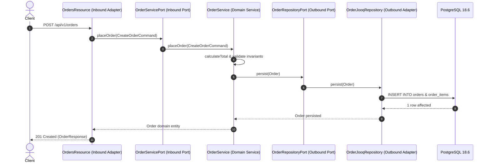

# Chapter 3: Pure Domain & jOOQ Persistence Layer

Here we implement the pure core domain using modern Java 25 features (Records, Pattern Matching, Sealed types) and configure Flyway and jOOQ for PostgreSQL 18.

---

## 1. Interaction Flow



---

## 2. Core Domain Models (Pure Java 25)

Create `src/main/java/com/example/orders/domain/model/Order.java`:

```java:src/main/java/com/example/orders/domain/model/Order.java
package com.example.orders.domain.model;

import java.math.BigDecimal;
import java.time.Instant;
import java.util.List;
import java.util.UUID;

public record Order(
    UUID id,
    String customerEmail,
    List<OrderItem> items,
    OrderStatus status,
    BigDecimal totalAmount,
    Instant createdAt
) {
    public Order {
        if (customerEmail == null || !customerEmail.contains("@")) {
            throw new IllegalArgumentException("Valid customer email is required");
        }
        if (items == null || items.isEmpty()) {
            throw new IllegalArgumentException("An order must contain at least one item");
        }
        if (totalAmount == null || totalAmount.compareTo(BigDecimal.ZERO) <= 0) {
            throw new IllegalArgumentException("Total amount must be greater than zero");
        }
    }

    public static Order createNew(String customerEmail, List<OrderItem> items) {
        BigDecimal total = items.stream()
                .map(item -> item.unitPrice().multiply(BigDecimal.valueOf(item.quantity())))
                .reduce(BigDecimal.ZERO, BigDecimal::add);

        return new Order(
                UUID.randomUUID(),
                customerEmail,
                List.copyOf(items),
                OrderStatus.PENDING,
                total,
                Instant.now()
        );
    }
}
```

Create `src/main/java/com/example/orders/domain/model/OrderItem.java`:

```java:src/main/java/com/example/orders/domain/model/OrderItem.java
package com.example.orders.domain.model;

import java.math.BigDecimal;

public record OrderItem(String productSku, int quantity, BigDecimal unitPrice) {
    public OrderItem {
        if (quantity <= 0) {
            throw new IllegalArgumentException("Quantity must be positive");
        }
        if (unitPrice == null || unitPrice.compareTo(BigDecimal.ZERO) <= 0) {
            throw new IllegalArgumentException("Unit price must be positive");
        }
    }
}
```

Create `src/main/java/com/example/orders/domain/model/OrderStatus.java`:

```java:src/main/java/com/example/orders/domain/model/OrderStatus.java
package com.example.orders.domain.model;

public enum OrderStatus {
    PENDING,
    CONFIRMED,
    SHIPPED,
    CANCELLED
}
```

---

## 3. Inbound and Outbound Ports

Create the outbound port `src/main/java/com/example/orders/ports/outbound/OrderRepositoryPort.java`:

```java:src/main/java/com/example/orders/ports/outbound/OrderRepositoryPort.java
package com.example.orders.ports.outbound;

import com.example.orders.domain.model.Order;
import java.util.List;
import java.util.Optional;
import java.util.UUID;

public interface OrderRepositoryPort {
    void save(Order order);
    Optional<Order> findById(UUID orderId);
    List<Order> findAll();
}
```

Create the inbound port `src/main/java/com/example/orders/ports/inbound/OrderUseCasePort.java`:

```java:src/main/java/com/example/orders/ports/inbound/OrderUseCasePort.java
package com.example.orders.ports.inbound;

import com.example.orders.domain.model.Order;
import com.example.orders.domain.model.OrderItem;
import java.util.List;
import java.util.Optional;
import java.util.UUID;

public interface OrderUseCasePort {
    Order createOrder(String customerEmail, List<OrderItem> items);
    Optional<Order> getOrder(UUID orderId);
    List<Order> listAllOrders();
}
```

---

## 4. Domain Service Implementation

Create `src/main/java/com/example/orders/domain/service/OrderService.java`:

```java:src/main/java/com/example/orders/domain/service/OrderService.java
package com.example.orders.domain.service;

import com.example.orders.domain.model.Order;
import com.example.orders.domain.model.OrderItem;
import com.example.orders.ports.inbound.OrderUseCasePort;
import com.example.orders.ports.outbound.OrderRepositoryPort;
import jakarta.enterprise.context.ApplicationScoped;
import jakarta.inject.Inject;

import java.util.List;
import java.util.Optional;
import java.util.UUID;

@ApplicationScoped
public class OrderService implements OrderUseCasePort {

    private final OrderRepositoryPort orderRepository;

    @Inject
    public OrderService(OrderRepositoryPort orderRepository) {
        this.orderRepository = orderRepository;
    }

    @Override
    public Order createOrder(String customerEmail, List<OrderItem> items) {
        Order order = Order.createNew(customerEmail, items);
        orderRepository.save(order);
        return order;
    }

    @Override
    public Optional<Order> getOrder(UUID orderId) {
        return orderRepository.findById(orderId);
    }

    @Override
    public List<Order> listAllOrders() {
        return orderRepository.findAll();
    }
}
```

---

## 5. PostgreSQL 18 Migration Script (Flyway)

Create `src/main/resources/db/migration/V1__init_orders_schema.sql`:

```sql:src/main/resources/db/migration/V1__init_orders_schema.sql
CREATE TABLE orders (
    id UUID PRIMARY KEY,
    customer_email VARCHAR(255) NOT NULL,
    total_amount NUMERIC(12, 2) NOT NULL,
    status VARCHAR(50) NOT NULL,
    created_at TIMESTAMP WITH TIME ZONE NOT NULL DEFAULT NOW()
);

CREATE TABLE order_items (
    id BIGSERIAL PRIMARY KEY,
    order_id UUID NOT NULL REFERENCES orders(id) ON DELETE CASCADE,
    product_sku VARCHAR(100) NOT NULL,
    quantity INT NOT NULL,
    unit_price NUMERIC(12, 2) NOT NULL
);

CREATE INDEX idx_orders_customer_email ON orders(customer_email);
CREATE INDEX idx_order_items_order_id ON order_items(order_id);
```