# Chapter 6: Helm Packaging & K3d Deployment

In this final chapter, we package our microservice into a production-grade **Helm Chart** and deploy it to a local lightweight **K3d / K3s** Kubernetes cluster.

---

## 1. Deployment Topology

```mermaid
graph LR
    classDef ingress fill:#38bdf8,stroke:#0284c7,stroke-width:2px,color:#0f172a;
    classDef svc fill:#818cf8,stroke:#4f46e5,stroke-width:2px,color:#ffffff;
    classDef pod fill:#4ade80,stroke:#15803d,stroke-width:2px,color:#052e16;
    classDef db fill:#f97316,stroke:#c2410c,stroke-width:2px,color:#ffffff;

    Host["Host Machine (:8081)"] --> Traefik["K3s Traefik Ingress Controller"]:::ingress
    Traefik --> OrderService["order-service (ClusterIP: 8080)"]:::svc
    OrderService --> Pods["Order Service Pod (Quarkus + Java 25)"]:::pod
    Pods --> PostgresSvc["postgres-service (ClusterIP: 5432)"]:::svc
    PostgresSvc --> PostgresPod["Postgres 18.6 Pod (StatefulSet)"]:::db
```



---

## 2. Helm Chart Structure

Generate the chart skeleton:

```bash
mkdir -p helm/order-service/templates
```

Create `helm/order-service/Chart.yaml`:

```yaml:helm/order-service/Chart.yaml
apiVersion: v2
name: order-service
description: Helm chart for Hexagonal Quarkus Order Microservice
type: application
version: 1.0.0
appVersion: "1.0.0"
```

Create `helm/order-service/values.yaml`:

```yaml:helm/order-service/values.yaml
replicaCount: 2

image:
  repository: order-service
  tag: latest
  pullPolicy: IfNotPresent

service:
  type: ClusterIP
  port: 8080

ingress:
  enabled: true
  path: /api/v1/orders
  pathType: Prefix

resources:
  limits:
    cpu: 1000m
    memory: 512Mi
  requests:
    cpu: 250m
    memory: 256Mi

postgres:
  image: postgres:18-alpine
  dbName: orderdb
  user: postgres
  password: postgresSuperSecretPassword
  port: 5432
```

Create `helm/order-service/templates/postgres.yaml`:

```yaml:helm/order-service/templates/postgres.yaml
apiVersion: apps/v1
kind: Deployment
metadata:
  name: {{ .Release.Name }}-postgres
spec:
  replicas: 1
  selector:
    matchLabels:
      app: {{ .Release.Name }}-postgres
  template:
    metadata:
      labels:
        app: {{ .Release.Name }}-postgres
    spec:
      containers:
        - name: postgres
          image: {{ .Values.postgres.image }}
          env:
            - name: POSTGRES_DB
              value: {{ .Values.postgres.dbName }}
            - name: POSTGRES_USER
              value: {{ .Values.postgres.user }}
            - name: POSTGRES_PASSWORD
              value: {{ .Values.postgres.password }}
          ports:
            - containerPort: 5432
---
apiVersion: v1
kind: Service
metadata:
  name: {{ .Release.Name }}-postgres
spec:
  ports:
    - port: 5432
      targetPort: 5432
  selector:
    app: {{ .Release.Name }}-postgres
```

Create `helm/order-service/templates/deployment.yaml`:

```yaml:helm/order-service/templates/deployment.yaml
apiVersion: apps/v1
kind: Deployment
metadata:
  name: {{ .Release.Name }}
spec:
  replicas: {{ .Values.replicaCount }}
  selector:
    matchLabels:
      app: {{ .Release.Name }}
  template:
    metadata:
      labels:
        app: {{ .Release.Name }}
    spec:
      containers:
        - name: {{ .Chart.Name }}
          image: "{{ .Values.image.repository }}:{{ .Values.image.tag }}"
          imagePullPolicy: {{ .Values.image.pullPolicy }}
          ports:
            - containerPort: {{ .Values.service.port }}
          env:
            - name: QUARKUS_DATASOURCE_JDBC_URL
              value: "jdbc:postgresql://{{ .Release.Name }}-postgres:{{ .Values.postgres.port }}/{{ .Values.postgres.dbName }}"
            - name: QUARKUS_DATASOURCE_USERNAME
              value: "{{ .Values.postgres.user }}"
            - name: QUARKUS_DATASOURCE_PASSWORD
              value: "{{ .Values.postgres.password }}"
          livenessProbe:
            httpGet:
              path: /health/live
              port: {{ .Values.service.port }}
            initialDelaySeconds: 5
            periodSeconds: 10
          readinessProbe:
            httpGet:
              path: /health/ready
              port: {{ .Values.service.port }}
            initialDelaySeconds: 5
            periodSeconds: 5
          resources:
            {{- toYaml .Values.resources | nindent 12 }}
```

Create `helm/order-service/templates/service.yaml`:

```yaml:helm/order-service/templates/service.yaml
apiVersion: v1
kind: Service
metadata:
  name: {{ .Release.Name }}
spec:
  type: {{ .Values.service.type }}
  ports:
    - port: {{ .Values.service.port }}
      targetPort: {{ .Values.service.port }}
      protocol: TCP
      name: http
  selector:
    app: {{ .Release.Name }}
```

Create `helm/order-service/templates/ingress.yaml`:

```yaml:helm/order-service/templates/ingress.yaml
apiVersion: networking.k8s.io/v1
kind: Ingress
metadata:
  name: {{ .Release.Name }}
spec:
  rules:
    - http:
        paths:
          - path: /
            pathType: Prefix
            backend:
              service:
                name: {{ .Release.Name }}
                port:
                  number: {{ .Values.service.port }}
```

---

## 3. Provisioning K3d Cluster & Deploying

### Step 3.1: Create K3d Cluster with Ingress Port Mapped
```bash
k3d cluster create order-cluster --servers 1 --agents 2 --port "8081:80@loadbalancer"
```

### Step 3.2: Build the Container Image and Import into K3d
```bash
docker build -f src/main/docker/Dockerfile.jvm -t order-service:latest .
k3d image import order-service:latest -c order-cluster
```

### Step 3.3: Deploy the Helm Chart
```bash
helm install order-service ./helm/order-service
```

### Step 3.4: Verify Deployment and Pod Readiness
```bash
kubectl get pods -w
```

Once all pods display `Running` and `1/1 Ready`, test the endpoint exposed through the K3d Ingress port:

```bash
curl -X POST http://localhost:8081/api/v1/orders \
  -H "Content-Type: application/json" \
  -d '{
    "customerEmail": "k3d-user@example.com",
    "items": [
      {
        "productSku": "K8S-BOOK-01",
        "quantity": 1,
        "unitPrice": 59.90
      }
    ]
  }' | jq .
```

### Step 3.5: Clean Up
```bash
helm uninstall order-service
k3d cluster delete order-cluster
```