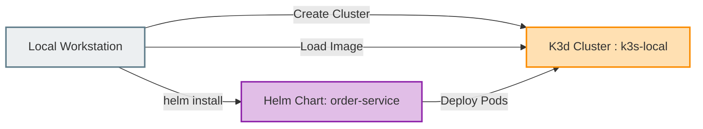

# Chapter 6: Helm Packaging & K3d Deployment

**Milestone:** Package the application into a reusable Helm chart and deploy onto a lightweight local K3d (K3s) Kubernetes cluster.

---

## 1. K3d Cluster Provisioning Flow



Create the K3d cluster with forwarded ports:

```bash
k3d cluster create order-cluster \
  --servers 1 \
  --agents 1 \
  --port 8080:80@loadbalancer
```

---

## 2. Helm Chart Architecture

Directory structure:

```text
helm/
└── order-service/
    ├── Chart.yaml
    ├── values.yaml
    └── templates/
        ├── _helpers.tpl
        ├── configmap.yaml
        ├── deployment.yaml
        └── service.yaml
```

### `Chart.yaml`
```yaml
apiVersion: v2
name: order-service
description: Hexagonal Java 25 Quarkus Order Service
type: application
version: 1.0.0
appVersion: "1.0.0"
```

### `values.yaml`
```yaml
replicaCount: 2

image:
  repository: order-service
  tag: latest
  pullPolicy: IfNotPresent

service:
  type: ClusterIP
  port: 8080

env:
  QUARKUS_DATASOURCE_JDBC_URL: "jdbc:postgresql://postgres:5432/order_db"
  QUARKUS_DATASOURCE_USERNAME: "app_user"
  QUARKUS_DATASOURCE_PASSWORD: "app_secret"

resources:
  limits:
    cpu: 1000m
    memory: 512Mi
  requests:
    cpu: 250m
    memory: 256Mi

livenessProbe:
  httpGet:
    path: /health/live
    port: 8080
  initialDelaySeconds: 10
  periodSeconds: 10

readinessProbe:
  httpGet:
    path: /health/ready
    port: 8080
  initialDelaySeconds: 5
  periodSeconds: 5
```

### `templates/deployment.yaml`
```yaml
apiVersion: apps/v1
kind: Deployment
metadata:
  name: {{ include "order-service.fullname" . }}
  labels:
    app: {{ include "order-service.name" . }}
spec:
  replicas: {{ .Values.replicaCount }}
  selector:
    matchLabels:
      app: {{ include "order-service.name" . }}
  template:
    metadata:
      labels:
        app: {{ include "order-service.name" . }}
    spec:
      containers:
        - name: {{ .Chart.Name }}
          image: "{{ .Values.image.repository }}:{{ .Values.image.tag }}"
          imagePullPolicy: {{ .Values.image.pullPolicy }}
          ports:
            - containerPort: 8080
          env:
            - name: QUARKUS_DATASOURCE_JDBC_URL
              value: {{ .Values.env.QUARKUS_DATASOURCE_JDBC_URL | quote }}
            - name: QUARKUS_DATASOURCE_USERNAME
              value: {{ .Values.env.QUARKUS_DATASOURCE_USERNAME | quote }}
            - name: QUARKUS_DATASOURCE_PASSWORD
              value: {{ .Values.env.QUARKUS_DATASOURCE_PASSWORD | quote }}
          livenessProbe:
            {{- toYaml .Values.livenessProbe | nindent 12 }}
          readinessProbe:
            {{- toYaml .Values.readinessProbe | nindent 12 }}
          resources:
            {{- toYaml .Values.resources | nindent 12 }}
```

### `templates/service.yaml`
```yaml
apiVersion: v1
kind: Service
metadata:
  name: {{ include "order-service.fullname" . }}
spec:
  type: {{ .Values.service.type }}
  ports:
    - port: {{ .Values.service.port }}
      targetPort: 8080
  selector:
    app: {{ include "order-service.name" . }}
```

---

## 3. Build, Import, and Deploy

Execute the deployment pipeline to K3d:

```bash
# 1. Build Docker image locally
docker build -f src/main/docker/Dockerfile.jvm -t order-service:latest .

# 2. Import the image into the k3d cluster
k3d image import order-service:latest -c order-cluster

# 3. Deploy the Helm release
helm upgrade --install order-service ./helm/order-service

# 4. Verify Pod status
kubectl get pods -l app=order-service
```

Expected verification:
```text
NAME                             READY   STATUS    RESTARTS   AGE
order-service-674b89b4b9-x7k9p   1/1     Running   0          24s
order-service-674b89b4b9-9l8jm   1/1     Running   0          24s
```