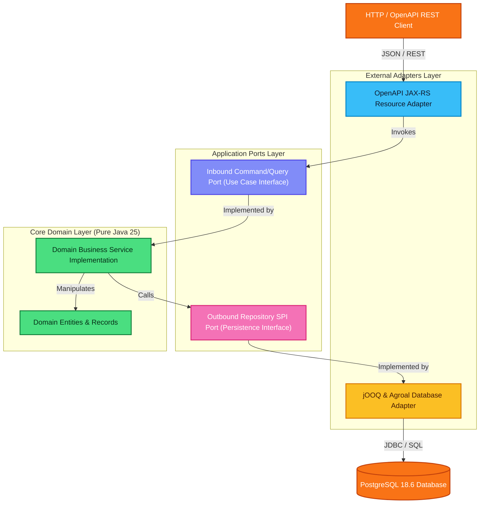

# Production-Grade Microservices with Quarkus, jOOQ, and Hexagonal Architecture

Welcome to this end-to-end, production-oriented tutorial. In this guide, you will build a robust microservice using the latest stack components: **Java 25**, **Gradle 9.8.2 (Kotlin DSL)**, **Quarkus 3.40**, **jOOQ**, **PostgreSQL 18.6**, **Docker Compose**, **Helm 3**, and **K3s/K3d**.

---

## 🏛️ System Architecture

Our service follows **Hexagonal Architecture** (Ports and Adapters) paired with **Clean Architecture** principles. The core business logic remains completely insulated from external frameworks, databases, and network transports.

---

## 📑 Table of Contents

| Chapter | File | Milestone & Focus |
|---|---|---|
| **Chapter 1** | [01-project-setup-and-gradle.md](./01-project-setup-and-gradle.md) | Gradle 9.8.2 Kotlin DSL build configuration, Java 25 toolchains, and Quarkus 3.40 dependency tree. |
| **Chapter 2** | [02-openapi-contract-first.md](./02-openapi-contract-first.md) | Contract-first API design using OpenAPI 3.1 YAML and automated code generation via OpenAPI Generator Gradle plugin. |
| **Chapter 3** | [03-hexagonal-domain-and-jooq.md](./03-hexagonal-domain-and-jooq.md) | Clean Domain logic, Inbound/Outbound Ports, PostgreSQL 18 schema migrations (Flyway), and jOOQ code-gen setup. |
| **Chapter 4** | [04-adapters-and-wiring.md](./04-adapters-and-wiring.md) | Implementing JAX-RS inbound HTTP controllers and jOOQ outbound persistence repositories, wired with Quarkus CDI. |
| **Chapter 5** | [05-local-infrastructure-compose.md](./05-local-infrastructure-compose.md) | Multi-stage Dockerfile (JVM/Fast-JAR) and Docker Compose setup with PostgreSQL 18.6 and healthchecks. |
| **Chapter 6** | [06-helm-packaging-and-k3d.md](./06-helm-packaging-and-k3d.md) | Cloud-native packaging with Helm charts and running integration flows on a local K3d/K3s Kubernetes cluster. |

---

## 🚀 Prerequisites

Ensure the following tools are installed on your workstation:
- **JDK 25** (e.g., Eclipse Temurin or OpenJDK 25)
- **Docker** & **Docker Compose v2+**
- **k3d** (`curl -s https://raw.githubusercontent.com/k3d-io/k3d/main/install.sh | bash`)
- **kubectl** & **helm 3+**
- **curl** and **jq**