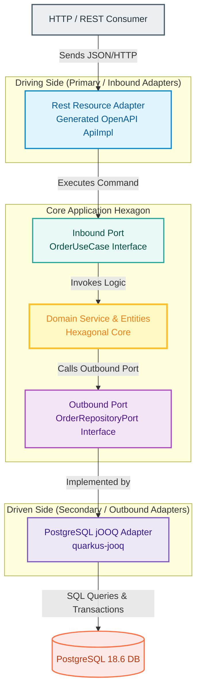
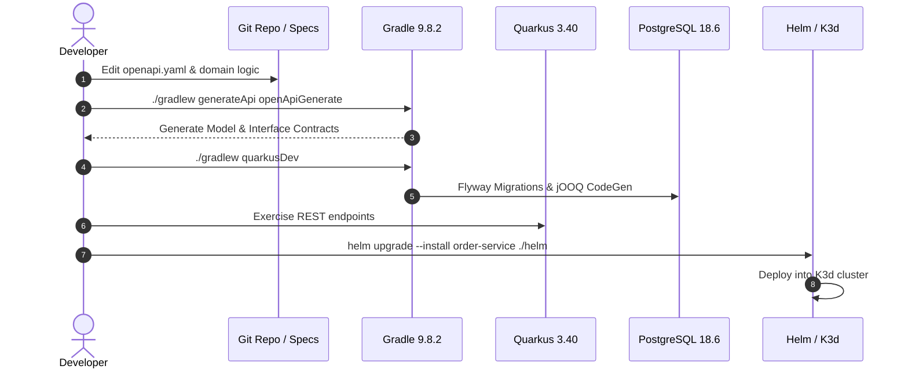

# End-to-End Enterprise Microservice Tutorial: Cloud-Native Java 25 & Quarkus 3.40

Welcome to the definitive hands-on guide for engineering a production-grade microservice. This tutorial takes you through a modern cloud-native stack using modern patterns: Hexagonal Architecture, Contract-First OpenAPI code generation, type-safe jOOQ database interaction, Docker Compose local provisioning, and declarative deployment via Helm onto a lightweight K3s/K3d Kubernetes cluster.

---

## 🛠 Tech Stack & Versions

| Layer | Technology | Version |
| :--- | :--- | :--- |
| **Runtime** | Java OpenJDK | 25 |
| **Build Automation** | Gradle (Kotlin DSL) | 9.8.2 |
| **Framework** | Quarkus Framework | 3.40 |
| **Persistence Query Engine** | jOOQ (via `quarkus-jooq`) | Built-in / Quarkus aligned |
| **Database** | PostgreSQL | 18.6 |
| **Contract / API Spec** | OpenAPI 3.1 YAML + Generator plugin | 7.x+ |
| **Local Infrastructure** | Docker Compose | v2+ |
| **Deployment Engine** | Helm Chart & K3d / K3s | v3+ / latest |

---

## 🏗 High-Level Architectural Blueprint

We implement **Hexagonal Architecture (Ports and Adapters)** combined with **Clean Architecture** principles. The domain model sits strictly in the center, free from any framework or database driver dependencies.

---

## 📑 Tutorial Table of Contents

Follow the step-by-step milestones below. Each chapter corresponds to an isolated, verifiable milestone:

1. [**Chapter 1: Scaffolding the Gradle Build & Quarkus Stack**](chapter_01_scaffolding.md)
   * *Milestone:* Configure Gradle 9.8.2 (Kotlin DSL) targeting Java 25 and Quarkus 3.40 with all required plugin dependencies.
2. [**Chapter 2: Contract-First API Spec & Automated Code Generation**](chapter_02_openapi_contract.md)
   * *Milestone:* Design an OpenAPI 3.1 YAML definition and wire up a Gradle build task to auto-generate Jax-RS interfaces and DTOs.
3. [**Chapter 3: Hexagonal & Clean Architecture Code Structure**](chapter_03_hexagonal_architecture.md)
   * *Milestone:* Structure domain entities, inbound/outbound ports, and domain services strictly isolated from framework annotations.
4. [**Chapter 4: Persistence with PostgreSQL 18.6 and jOOQ**](chapter_04_jooq_postgres.md)
   * *Milestone:* Configure PostgreSQL 18.6 container, Flyway schema migrations, and generate/execute type-safe SQL with jOOQ.
5. [**Chapter 5: Containerization & Docker Compose Local Environment**](chapter_05_docker_compose.md)
   * *Milestone:* Multi-stage container builds using Java 25 Alpine / Distroless and automated end-to-end local Docker Compose orchestration.
6. [**Chapter 6: Helm Packaging & K3d/K3s Kubernetes Deployment**](chapter_06_helm_k3d.md)
   * *Milestone:* Package the microservice into a production-grade Helm 3 chart and execute a local cluster verification on K3d/K3s.

---

## 🚀 Recommended Verification Workflow

